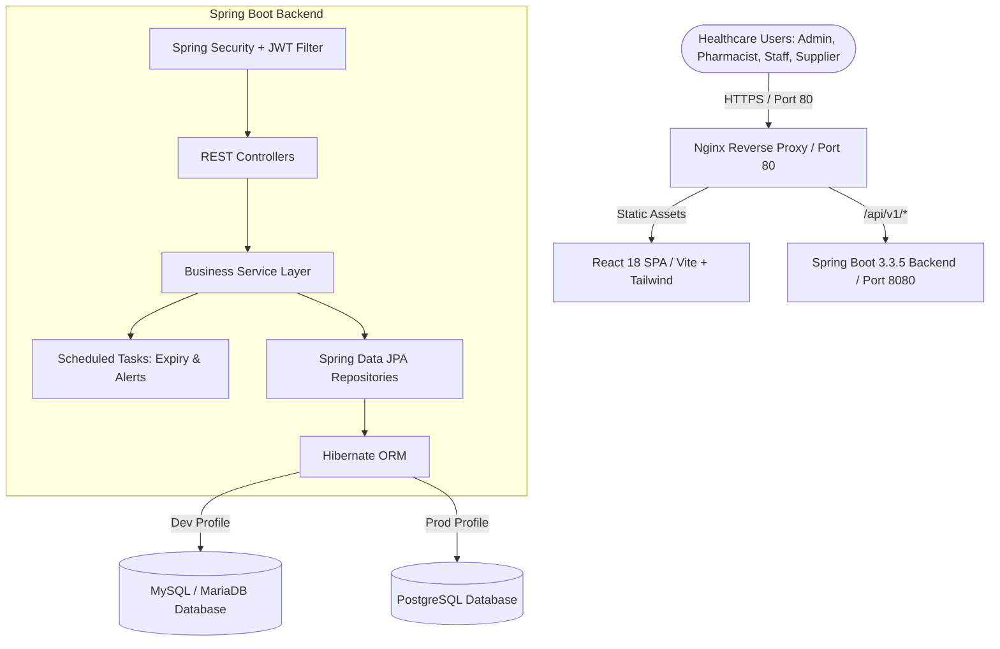
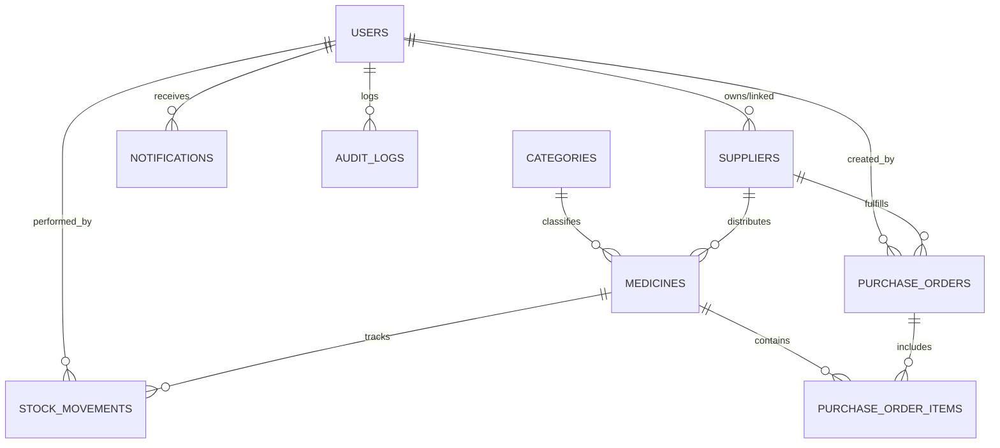

# MediStock Architecture & Technical Specification

## 1. System Overview

**MediStock** is an enterprise-grade medical inventory intelligence platform architected for healthcare institutions, pharmacies, clinics, and pharmaceutical supply chains. The application provides end-to-end inventory tracking, expiry monitoring, procurement workflows, role-based authorization, and regulatory audit logging.

---

## 2. Layered Architecture

1. **Presentation Layer (React 18 SPA):**
   - Clean, modular component architecture built with JavaScript JSX (strictly no TypeScript).
   - Global state managed via React Context (`AuthContext`, `NotificationContext`).
   - Tailwind CSS for modern responsive styling.
   - Framer Motion for smooth modal and alert transitions.
   - Chart.js with react-chartjs-2 for analytical dashboards.

2. **Security & Gateway Layer:**
   - Stateless JWT authentication via `JwtAuthenticationFilter`.
   - BCrypt password hashing (12 salt rounds).
   - Method-level security annotations (`@PreAuthorize("hasRole('ADMIN')")`).
   - CORS policy configuration for multi-origin deployments.

3. **Service Layer (Domain Logic):**
   - Transactional business workflows (`@Transactional`).
   - Business rules for expiry checks, reorder levels, and stock movements.
   - Strict supplier data isolation enforced at the service boundary.
   - OpenPDF and Apache POI document generation services.

4. **Persistence Layer (Spring Data JPA / Hibernate):**
   - Database portability between MySQL (local/XAMPP) and PostgreSQL (production).
   - Automatic optimistic locking and indexing on high-cardinality fields (`sku`, `email`, `poNumber`).
   - Cascade rules preventing orphan records.

---

## 3. Database Schema & ER Design

### Table Definitions:
1. `users`: Stores user identity, BCrypt hashed passwords, security roles (`ADMIN`, `PHARMACIST`, `STAFF`, `SUPPLIER`), and account status (`ACTIVE`, `PENDING`, `INACTIVE`, `SUSPENDED`).
2. `suppliers`: Vendor profiles, contact details, pharmaceutical license numbers, and approval status.
3. `categories`: Pharmaceutical categories (e.g. Antibiotics, Analgesics, Cardiac).
4. `medicines`: SKU, generic name, batch number, quantity on hand, reorder level, unit price, manufacturing and expiry dates.
5. `stock_movements`: Immutable ledger tracking `STOCK_IN`, `STOCK_OUT`, `ADJUSTMENT`, `RETURN`, and `DISPOSAL`.
6. `purchase_orders`: PO numbers, target dates, supplier IDs, statuses (`PENDING`, `APPROVED`, `SHIPPED`, `DELIVERED`, `CANCELLED`).
7. `purchase_order_items`: Quantity ordered, quantity received, unit price, subtotal.
8. `notifications`: Real-time alerts for expiry and low stock.
9. `audit_logs`: Regulatory trail tracking user actions, target entities, timestamps, and IP addresses.

---

## 4. Supplier Data Isolation

To prevent vendor data leakage, supplier authorization is enforced at the database query level:
- In `SupplierServiceImpl.java`, any request by a user with role `SUPPLIER` verifies that the accessed supplier ID matches the authenticated user's linked supplier record.
- In `PurchaseOrderServiceImpl.java`, queries initiated by a supplier automatically apply `WHERE po.supplier_id = :supplierId`.
- Other suppliers' orders, customer data, and sales figures are strictly inaccessible.

---

## 5. Stock Movement & Expiry Enforcement

1. **Dispensing Safeguards:**
   - A medicine marked `EXPIRED` cannot be dispensed via `STOCK_OUT`.
   - Expired items must be written off using the audited `DISPOSAL` movement type.
2. **Automated Scheduled Audits:**
   - A daily cron job (`StockExpiryScheduler`) scans all medicines. Items with `expiry_date < CURRENT_DATE` are automatically updated to `EXPIRED` and trigger priority notifications.
   - Items with expiry within 60 days generate warning alerts.
3. **Goods Receipt Inflow:**
   - When receiving items from a purchase order, `PurchaseOrderService.receiveStock()` increments inventory and writes `STOCK_IN` movements in an atomic database transaction.
